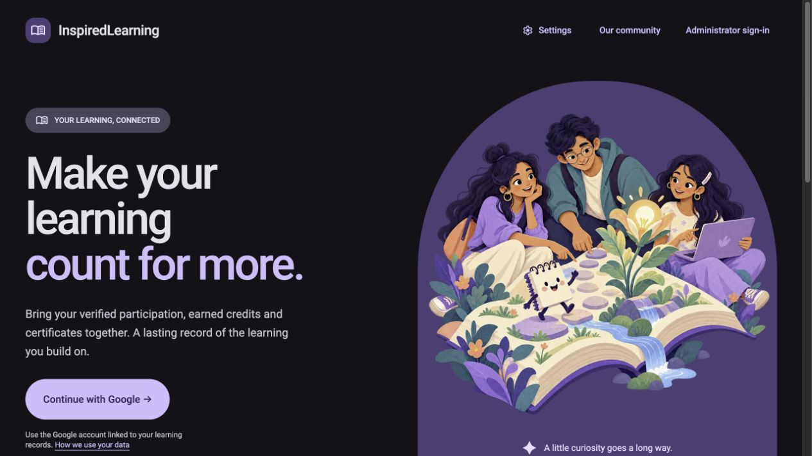
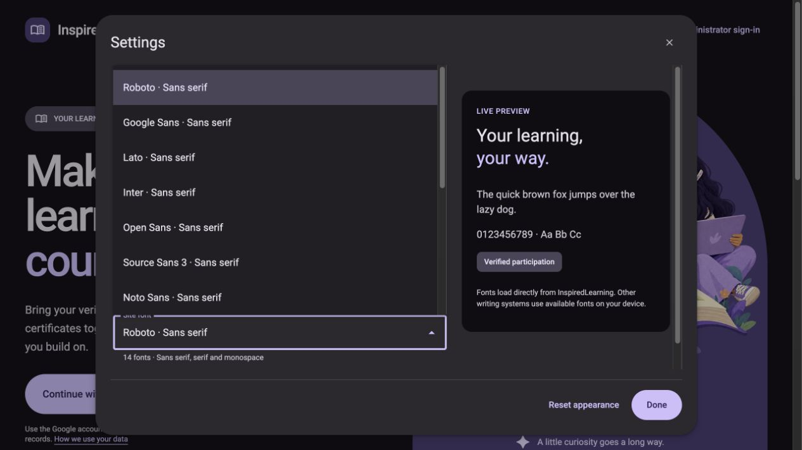

# InspiredLearning 2.2.2 production evidence

Explicit owner authorization: “Deploy it please. Don't wait for me if things arew checked out.” Scope: existing learner/admin Hosting and nine InspiredLearning Functions. No Auth/DNS/rules/index changes, new credentials, paid provisioning, learner writes, alerts or membership migration.

Deployed immutable revision **298cc4f5db4bc692d612ded84a4c4cb7b3907b6e**: app **2.2.2**, Functions **2.0.2**, API **1.5.0**. MCP **1.0.2** is local stdio source, not deployed hosting. [Published release](https://github.com/theharithsa/inspiredlearning/releases/tag/v2.2.2). Source 2.2.1 changes are included; no separate 2.2.1 deployment occurred.

## Source and preflight

- Dependency consolidation PR #84 and independent decoder PR #85 merged after review and exact-head CI. [Deployed-main Checks](https://github.com/theharithsa/inspiredlearning/actions/runs/41180934169) passed: 63 browser, 56 unit, 49 integration and 22 backend tests, plus Auth, Swagger, MCP, tooling/PubSub, security and Hosting gates.
- Production dependency audits passed. Nine development-only Firebase CLI advisory nodes remain in #83; no forced downgrade. Firebase 13/rules 6 proposals #86/#87 and router #89 are outside this release.
- Clean production build used existing ignored public web configuration, with emulator settings disabled. Both surface manifests carry the exact revision and environment. 121 artifact files were hashed before deployment. Root index SHA256: `549f15104c51c78059f62564fed70bdded8b395466a5d0caf01bc9374493a281`.
- Existing provider configuration, Secret Manager version metadata and rollback source were checked without exposing secret values. Node runtime 22.23.4 satisfies the new SDK minimum. Preserve existing `SHARED_RATE_LIMITS=true`, existing secret version 3, capacity and identity policy.

## Deployment and checks

31 October 2026, Firebase project `chaicloud-workshop`, region `asia-south1`:

1. `npx --no-install firebase deploy --only functions:inspiredlearning --project chaicloud-workshop --non-interactive` — all nine functions updated successfully and ACTIVE.
2. `npx --no-install firebase deploy --config firebase.admin.json --only hosting:inspiredlearning-admin --project chaicloud-workshop --non-interactive` — admin version `516358242fdab673`, provider release `1793433241644000`, **07:54:01.644 UTC**.
3. `npx --no-install firebase deploy --only hosting:inspiredlearning --project chaicloud-workshop --non-interactive` — learner version `9371897dcceedfd6`, provider release `1793433256182000`, **07:54:16.182 UTC**.
4. `node scripts/verify-release.mjs` — both production origins match app/revision/API; anonymous admin access denied.

Independent postchecks passed: **all 121 live artifact files** match the build; no-cache SPA HTML (including rewritten privacy path), enforced CSP, asynchronous RUM, immutable hashed JS, no-store API/docs/Swagger initializer, API schema 1.5.0, anonymous admin 401, missing-certificate privacy and three already-opted-in existing public certificates. No public visibility switches, reconciliation, reissuance or PDF writes were used as smoke tests.

Browser checks: production learner session restored successfully; fresh Google admin OAuth in desktop Safari reached Integrations/API access with the compact token form, no token creation. Admin overview showed the Google photo and aligned sidebar actions. The public landing and Settings font menu were inspected on the deployed Firebase alias (same verified release); 14 font choices are exposed. Compact 390×844 layout had no horizontal overflow. Existing appearance preferences were not reset. Screenshots below contain anonymous public content only.

Not rerun in this deployment: complete private route-by-route/theme review, physical-device tests, private PDF download/step-up, controlled session refresh/tab-close lifecycle. Prior CI and historical production evidence are retained separately; fresh OAuth is not proof of all those journeys.

## Preservation

Before and after selected-field read-only projections match:

- GMU0810: **196 certificate documents** — 119 issued participation, 38 issued awards, 39 revoked versions. Projection SHA256 `867828d26153884a6558a4a9e89a493f6792ca0732a31a5470692298683b1ef2`.
- All **119** corresponding workshop credit/completion projections match, SHA256 `f05952de80aa0b54f5c8e19ebb0ef49e18ca48a70e157f7a1aa73f0af0e67216`. Fields include personal/team credits, learningPoints, status, resultVersion and certificateId. These are scoped projections, not whole-database comparisons.
- Auth authorized domains unchanged, SHA256 `cfa04aad4d812cd75b9357c7f89c8c6f2243c2240f1f8671d4fc593cf64bc7da`.
- All eight unrelated ChaiCart functions unchanged after normalizing only unordered `eventTrigger.eventFilters` array order; raw provider serialization reordered one array. No other metadata normalization used.
- Unrelated Hosting versions unchanged: ChaiCart `62e49b5bcc174654`, project site `3e1b149e54d87fa3`.
- Dedicated function policy unchanged: runtime, memory, timeouts, concurrency, min/max instances, CPU, service account, ingress/VPC, secret bindings and authenticated shared limits.

[Sanitized check summary](evidence/v2.2.2/checks.json). Raw projections, environment metadata, deployment logs and rollback archive stay in private local storage; never publish them as evidence.

## Observability

Tenant queries after rollout found new **Functions 2.0.2** native spans (Node 22.23.4; API, action, delivery and retry functions), logs and `inspiredlearning.operation.outcomes` metrics. Controlled anonymous access request `c36f1387-9929-402e-bcd8-4eb3716197bb` returned 401 and its structured log is searchable. A direct hex-string trace lookup did not return a matching span; no request-level cross-signal correlation is certified from that lookup.

Both app **2.2.2** surfaces have searchable `inspiredlearning-rum` observations with `event.authority=client-observed`. Those observations are separate from canonical server-confirmed outbox outcomes. Native RUM-to-backend navigation and per-record OTLP acceptance receipts remain unverified; SDK completion callbacks are not such receipts.

`node scripts/observability/capture-deployment.mjs 2.2.2` observed both actual provider releases and independent public probes without deploying anything. [Reviewed receipts](evidence/v2.2.2/provider-observation.json) retain original deployment times and distinct probe observation times; four stable-ID events are queued for the existing trusted Production observer after this evidence PR merges. The reporter uses only the fixed reviewed default-branch file, never a PR-supplied path; historical 2.2.0 receipts remain preserved. No ingestion credential is read locally. Source merge, HTTP acceptance and tenant searchability must be reported separately. Automatic Functions deployment event capture and the platform `events.sdlc` work in #79 are not implemented by this Hosting capture.

## Recovery and remaining gates

Follow [independent recovery runbook](V2-RECOVERY-RUNBOOK.md). Previous Hosting versions: learner `7a60990658b3e00b`, admin `d858b41a07625334`. Previous Functions 2.0.1 source ZIP is retained privately (586,958 bytes; SHA256 `7cdca87440b79fb409aaf1479d52d5f6d81a5b115d294ecc1ff896113c990e87`) from immutable object generation `1793291410844987`. Restore compatible code/config only; no learner data rollback. No live rollback was performed.

#9 alert delivery remains deferred; #17 membership migration remains held; public-client protection #15, full visual acceptance #63, epic #34, observability #77/#79 and development-only CLI audit #83 are not automatically closed by a successful release.

## Public screenshots

Captured 31 October 2026 from `https://inspiredlearning-vh.web.app/`, verified revision above, system dark mode, Material violet/Roboto. Desktop viewport 1265×711; compact viewport 390×844. These browser screenshots are not physical-device certification.

